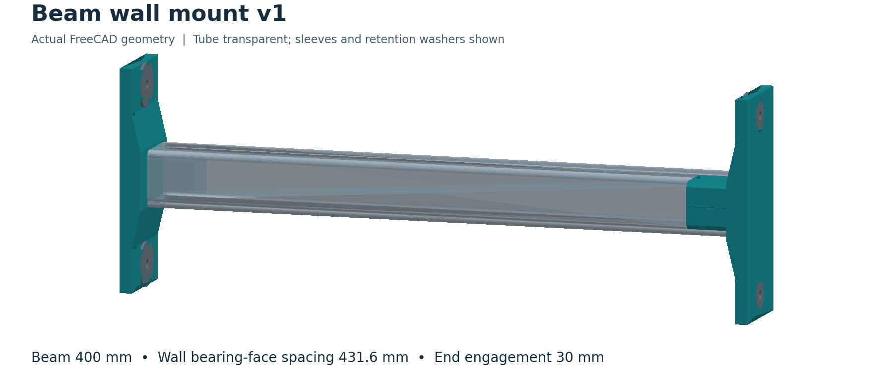
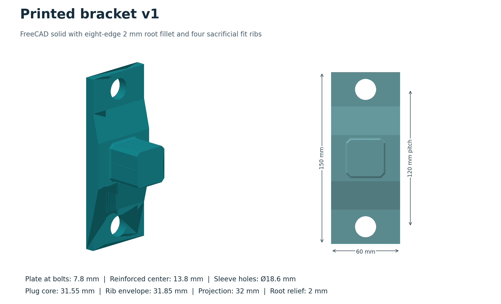
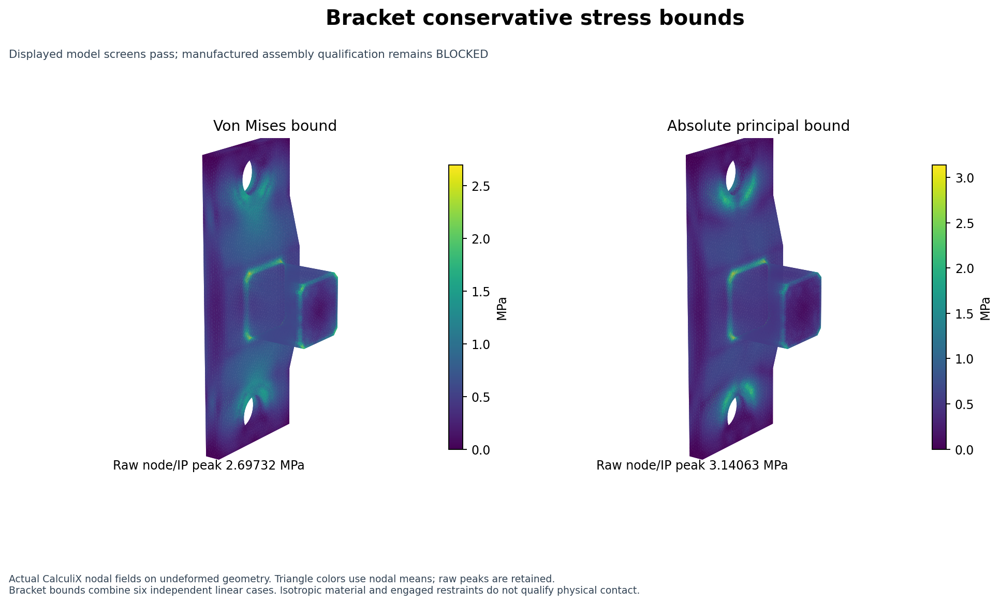
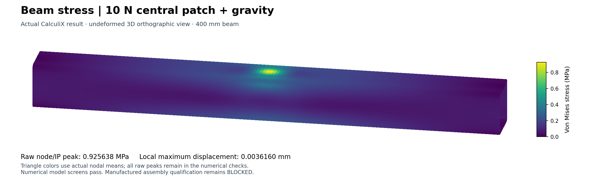

# 400 mm beam wall mount engineering report v1

Reconstructed design and verification record    19 November 2026

This version reconstructs the 400 mm aluminum beam and its two printed end brackets from the retained v0 report and conversation. It adds independent CadQuery and Open CASCADE fit checks, executable CI checks, saved run logs and instructions for the next iteration. The original v0 CAD and solver bytes were unavailable; all v1 geometry and numerical results are newly generated.

**Numerical verification: PASS. Nominal CAD fit: PASS. Manufactured fit and physical qualification: BLOCKED. Engineering release is not approved.**

Figure 1  Reconstructed FreeCAD assembly. The beam is 400 mm long; nominal wall bearing faces are 431.6 mm apart.



| Design quantity | v1 selection |
| --- | --- |
| Beam | Online Metals 23437; 6061-T6 square tube |
| Finished beam length | 400 +/-0.5 mm |
| Wall bearing-face spacing | 431.6 mm |
| Printed brackets | Two reinforced Prusament PETG parts |
| Load screen | 10 N quasistatic force in any direction plus selfweight |
| Material screen factor | 3 for aluminum and PETG only |

The force may act at any span station with a contact footprint of at least 10 x 10 mm. Anchor capacities use a separate service-load interaction. Load duration, environment, actual fit and installation remain unqualified.

## Reconstructed geometry and assembly

The flange is 7.8 mm thick at the bolt mounts. A 6 mm central reinforcement has a flat face over z=+/-20 mm and tapers to the flange at z=+/-45 mm. The plug begins at x=13.8 mm and projects 32 mm. A 2 mm root-relief gap leaves 30 mm of tube engagement. The 8-edge root fillet has 2 mm radius.

Figure 2  The printable v1 bracket. Four triangular fit ribs are reconstructed explicitly and are not credited with structural strength.



| Feature | Dimension | Purpose |
| --- | --- | --- |
| Flange | 60 x 150 mm | Two anchor mounts |
| Anchor pitch and bores | 120 mm; diameter 18.6 mm | Steel sleeves and M6 passage |
| Core and rib envelope | 31.55 /31.85 mm | Nominal clearance and sacrificial interference |
| Plug corner chamfer | 3 mm | Clear the rounded tube opening |
| Ribs | 1.2 mm base width; x 16 to 44.3 mm | Newly specified triangular ribs |
| Insertion allowance | 2 mm root relief; 30 mm engagement | Avoid tube contact with the root fillet |

The v1 rib and coupon details are reconstructed, so their volume can differ from v0. Both bracket instances and the actual delivered STEP solids are checked. Simplified anchor shanks show placement; thread, nut, expansion clip and supplied small washer are not modeled.

## Materials evidence and rounded tube section

Online Metals 23437 identifies ASTM B221 6061-T6 extrusion, 1.5 inch outside width, 0.125 inch wall, 0.125 inch outer radius and 0.062 inch inner radius. The actual nominal section therefore includes rounded corners [S1].

| Input | Value used | Basis |
| --- | --- | --- |
| Aluminum E /nu | 68,947.57 MPa /0.33 | Typical alloy guide [S5] |
| Aluminum yield reference | 240 MPa | Generic extrusion minimum [S4] |
| Aluminum density | 2800 kg/m³ | Conservative rounded guide assumption [S5] |
| PETG E /strength reference | 1400 /14 MPa | Lower typical references from specimen data [S6] |
| PETG density /nu | 1270 kg/m³ /0.38 | Density published; nu assumed [S6] |

The PETG sheet gives interlayer adhesion 18 +/-4 MPa and horizontal tensile modulus 1.5 +/-0.1 GPa. These are typical test results, not a qualified allowable for the actual print. The aluminum reference is not a certificate for the purchased stock. Retain lot and process qualification gates [S4 S6].

$$
A_s(b,r)=b^2-(4-\pi)r^2,\quad c=b/2-r
$$

$$
I_s(b,r)=\frac{b^4}{12}-4[c^2r^2(1-\pi/4)+cr^3/3+r^4(1/3-\pi/16)]
$$

$$
A=A_s(b,r_o)-A_s(b-2t,r_i),\quad I=I_s(b,r_o)-I_s(b-2t,r_i)
$$

At nominal dimensions, A=437.023 mm² and I=88,514.405 mm⁴. The tolerance enumeration uses outside flats +/-0.635 mm, wall +/-0.2032 mm and corner radii +/-0.396875 mm [S2]. It gives Amin=400.267 mm², Amax=474.481 mm², Imin=78,669.225 mm⁴ and Zmin=4,061.919 mm³.

Independent numerical integration checks the section formula. Tolerance extremes are combined conservatively; the actual tube opening still must be measured. A fixed nominal plug is not guaranteed to fit the full catalogue tolerance range.

## Beam force stress and displacement calculations

Use the upper finished span L=400.5 mm, F=10 N and g=9.80665 m/s². The beam bending model applies selfweight as a uniform load. The bracket envelope separately assigns all beam weight to one bracket.

Here b is the outside width, t the wall, cmax=bmax/2 and Z=Imin/cmax. The thin-wall torsion approximation uses a deliberately small enclosed area: Am=As(bmin−2tmax, ri, max), the rounded minimum inner opening. All section dimensions are in mm; E and stresses are in MPa.

$$
W=A_{max}L\rho g\,10^{-9},\quad q=W/L
$$

$$
M_{max}=FL/4+qL^2/8
$$

$$
M_e=Fc_{max}\sqrt2,\quad\sigma_b=\sqrt2(M_{max}+M_e)/Z,\quad\sigma_a=F/A_{min}
$$

$$
T=Fc_{max}\sqrt2,\quad\tau_T=T/(2A_m t_{min}),\quad\tau_V=1.5(F+W)/[2t_{min}(b_{min}-2t_{min})]
$$

$$
\sigma_{vm}=\sqrt{(\sigma_b+\sigma_a)^2+3(\tau_T+\tau_V)^2}
$$

W=5.218 N; Mmax=1,262.474 N mm; Me=273.898 N mm. The diagonal factor bounds transverse force direction. Combined beam stress is 0.633310 MPa against 240/3=80 MPa.

$$
\delta=FL^3/(48EI)+5qL^4/(384EI)+M_eL^2/(8EI)
$$

The calculated global beam displacement envelope is 0.00428456 mm against 1 mm. With nominal dimensions, centered vertical force and no end eccentricity, the comparable Euler section displacement is 0.00284020 mm. The FEM comparison uses a sidewall section mean; local indentation is reported separately.

$$
P_E=\pi^2EI/L^2,\quad P_{allow}=\min(P_E,\sigma_yA_{min})/3
$$

The pinned Euler compression screen gives PE=333,747.9 N and Pallow=32,021.3 N. The 10 N axial utilization is 0.0003123.

## Bracket and contact analytical screens

The bounding bracket volume is 158,690.4 mm³, deliberately above the actual CAD volume. Required force 17.194 N, torsion 476.108 N mm and transverse moment 1,536.372 N mm remain within the independently applied 20 N, 550 N mm and 1600 N mm envelopes.

For the screens below, R=20 N, T=550 N mm, Mt=1600 N mm, plug length ℓ=32 mm, anchor pitch s=120 mm, plate strip width w=60 mm and plate thickness tp=7.8 mm.

$$
A_p=B^2-2C^2
$$

$$
I_p=B^4/12-4[(C^2/2)(B/2-C/3)^2+C^4/36],\quad Z_p=I_p/(B/2)
$$

$$
\sigma_p=\sqrt2(R\ell+M_t)/Z_p+R/A_p,\quad\tau_p=1.5R/a^2+T/(0.208a^3)
$$

$$
\sigma_{p,vm}=\sqrt{\sigma_p^2+3\tau_p^2},\quad\delta_p=R\ell^3/(3E_pI_p)+M_t\ell^2/(2E_pI_p)
$$

With core B=31.55 mm and chamfer C=3 mm, Ap=977.403 mm² and Ip=78,630.434 mm⁴. The inscribed square for shear/torsion has side a=B-2C=25.55 mm. Plug stress is 0.746 MPa against 14/3=4.667 MPa; isolated plug displacement is 0.00943 mm.

$$
\sigma_{plate}=(Rs/4)/(wt_p^2/6),\quad F_c=R+M_t/(\ell_{eng}-10)
$$

$$
p_{bearing}=F_c/[(B-2C)10],\quad\sigma_{wall}=[F_c(b_{max}-2t_{min})/4]/(10t_{min}^2/6)
$$

The plate strip stress is 0.986 MPa. Two assumed 10 mm bearing patches in 30 mm engagement have centers 20 mm apart:Fc=20+1600/20=100 N. Bearing pressure is 0.391 MPa. The local tube wall strip gives 55.694 MPa against 80 MPa.

The contact patches are screening assumptions. Smaller edge contacts, rib crushing, assembly misalignment, anisotropy and long-term bearing require qualification. The finite element model excludes fit ribs from credited structural material.

## Anchors sleeves and installation load path

Each bracket uses two fischer 564572 M6 anchors at 120 mm pitch. The provisional wall is dry, sound solid C20/25 concrete, at least 100 mm thick and 60 mm from every free edge. The manufacturer requires 6 mm drilling, 60 mm minimum through-fixing hole depth and 8 N m torque [S8 S9 S14].

An 8 mm EN1A sleeve bypasses tightening compression around the printed plate. The 30 mm retention washer spans the 18.6 mm bore; retain the supplied anchor washer and nut above it. Each measured sleeve must project at least 0.1 mm above the print. Nominal projection is 0.2 mm, so the washer does not initially clamp the print [S10 S11].

$$
t_{fix,max}=(8+0.1)+(1.5+0.3)=9.9\;\mathrm{mm}\le10\;\mathrm{mm}
$$

$$
N=R+(Re+M_t)/s,\quad V=R+T/s
$$

$$
M_b=V(t_{fix,max}+0.5d)+Re+M_t
$$

$$
U=N/700+V/4300+M_b/6285.714\le1
$$

Using e=45.8 mm, s=120 mm, d=6 mm gives N=40.967 N, V=24.583 N and Mb=2,833.125 N mm. The linear interaction is 0.514965. One bolt is conservatively assigned the full direct load and global moment because equal sharing is not guaranteed.

The service references 700 N tension and 4300 N shear come from the published isolated-anchor table in cracked C20/25. The bending reference is 11 N m/(1.25 x 1.4)=6285.714 N mm. This screen does not replace the complete fastening design or qualify the custom fixture [S9 S14].

$$
F_{pre}=T_{inst}/(Kd),\quad A_{s,min}=\pi(17.6^2-6.5^2)/4
$$

With assumed torque factor K=0.15 to 0.25, estimated preload is 5333 to 8889 N. Minimum sleeve area is 210.102 mm² and nominal compression screen is 42.308 MPa. Actual washer bending, concrete bearing and preload remain unqualified.

## Independent geometric fit verification

CadQuery 2.7.0 imports the delivered STEP solids and uses Open CASCADE 7.8.1 to check validity, solid volumes, dimensions, poses and Boolean intersections. The tests use both physical end instances. They distinguish unwanted core collision from intentional sacrificial-rib interference and sample the insertion path before final seating.

| Geometric check | Status | Observed result |
| --- | --- | --- |
| Left core collision | PASS | 0.000000 mm³ |
| Left minimum core clearance | PASS | 0.100000 mm |
| Left intended rib intersection | PASS | 0.754667 mm³ |
| Left sampled insertion core collision | PASS | 0.000000 mm³ |
| Right core collision | PASS | 0.000000 mm³ |
| Right minimum core clearance | PASS | 0.100000 mm |
| Right intended rib intersection | PASS | 0.754667 mm³ |
| Right sampled insertion core collision | PASS | 0.000000 mm³ |
| Engagement at each end | PASS | 30.000 mm |
| Minimum sleeve clearance | PASS | 0.100 mm radial |
| Minimum washer overlap | PASS | 5.050 mm radial |
| Maximum fixture stack | PASS | 9.900 mm |
| Catalogue tolerance qualification | BLOCKED | Minimum catalogue opening 30.7086 mm; nominal core 31.55 mm |
| Physical press fit | BLOCKED | No measured print/stock insertion or retention evidence |

The kernel also checks all delivered solids, exact rounded profile, opposite-end pose, assembly instances, hardware bores and the complete dimensional stack. Current nominal geometry status: PASS. The full machine-readable observations are in results/geometric_fit.json.

All nominal checks are geometric statements about the reconstructed model. The catalogue tube opening can vary enough to defeat the fixed nominal plug. Measure both ends, select or regenerate fit coupons, and document insertion and retention before accepting a manufactured assembly. CAD cannot establish insertion force, rib crushing, print shrinkage or creep.

The test suite deliberately introduces defects such as an oversized or shifted core. Successful detection is evidence that the checks execute and discriminate failures. It does not change a failing engineering requirement to PASS.

## Finite element model and bracket stress

Gmsh 4.15.2 builds quadratic tetrahedral meshes for the reconstructed parts [M2]. CalculiX 2.23 solves six linear bracket cases: three 20 N force directions, 550 N mm torsion and two 1600 N mm transverse moments. The core includes the root fillet and reinforcement. The isotropic PETG model uses E=1400 MPa and nu=0.38.

The idealized attachment restrains transverse motion at sleeve bores and axial motion at wall/washer annuli. It assumes engaged bilateral contact. The actual 0.2 mm washer gap, slip, preload, friction and contact opening are not solved. These limitations require later contact analysis and physical qualification.

$$
S_{bound}=\sqrt{S_{fx}^2+S_{fy}^2+S_{fz}^2}+S_{tx}+\sqrt{S_{my}^2+S_{mz}^2}
$$

For each stress measure, the bound combines the norm of three force-case responses, the torsional response and the norm of two moment-case responses. Principal stress uses the spectral norm of the stress tensor. Nodal and integration-point maxima are retained without excluding peaks. A low stress magnitude does not establish mesh convergence.

Figure 3  Actual v1 CalculiX bracket stress fields and the conservative directional envelope. The figure records the current mesh and verification status.



| Mesh h (mm) | Elements | VM bound (MPa) | Principal bound (MPa) | Displacement (mm) |
| --- | --- | --- | --- | --- |
| 6.0 | 16,214 | 2.7376 | 3.0444 | 0.186059 |
| 4.5 | 24,447 | 2.6621 | 3.1074 | 0.185595 |
| 3.5 | 36,388 | 2.6973 | 3.1406 | 0.188089 |

## Beam finite element results and mesh verification

The beam model applies the centered 10 N load patch and gravity to nominal rounded geometry, with simply supported end sections and one axial restraint. A swept tetrahedral mesh starts from the actual STEP end face. Straight-sided quadratic displacement elements use an exact 100 mm² pressure patch integrated with clipped quadratic face shape functions. Gravity uses actual finite element volume; a separate gate compares that volume with CAD.

Figure 4  Actual v1 beam nodal stress field. Local displacement and the global section bending comparison are reported separately.



| Mesh h (mm) | Elements | Nodal VM (MPa) | IP VM (MPa) | Local displacement (mm) |
| --- | --- | --- | --- | --- |
| 8.0 | 36,000 | 0.8525 | 0.7917 | 0.003599 |
| 5.5 | 76,650 | 0.9256 | 0.8287 | 0.003616 |

| Verification | Status | Observed | Limit |
| --- | --- | --- | --- |
| Change in bracket VM bound | PASS | 1.31% | 10% |
| Change in bracket principal bound | PASS | 1.06% | 10% |
| Change in bracket displacement | PASS | 1.33% | 5% |
| Change in beam nodal VM | PASS | 7.90% | 10% |
| Change in beam IP VM | PASS | 4.47% | 10% |
| Change in beam displacement | PASS | 0.48% | 5% |
| FEM / Euler section difference | PASS | 7.63% | 15% |

Fine beam section displacement: 0.0030568 mm. Fine beam FE/CAD volume error: 0.1394%. Worst force/moment balance residual: 0.00027%. All element Jacobians are positive: True.

Limits are 10% stress change, 5% displacement change, 0.5% beam volume error, positive Jacobians, 0.5% equilibrium residual and 15% Euler comparison difference. Under gravity, the reaction audit subtracts consistent applied DLOAD nodal forces from CalculiX RF before checking equilibrium [M1].

The ZIP retains full raw stress/displacement fields for the six fine-bracket cases and one fine-beam case. Coarser meshes retain input decks, meshes, logs, metrics and raw-output SHA-256 values; their fields can be regenerated. fem/retained_evidence.json records this scope explicitly.

## Purchased parts and historical cost basis

The BOM uses exact catalogue identities and retained quotes dated 17 November 2026. Supplier dimensions and evidence were retrieved again for v1. The prices below remain historical; confirm final price, tax, minimum order and delivery before procurement. Current availability is not inferred from generic page templates.

| Part | Used | Buy | Unit quote | Purchase cost |
| --- | --- | --- | --- | --- |
| 23437 | 1 piece cut to 400 mm | 1 | USD 13.61 | USD 13.61 |
| IDS 3449 / IDF 17558 | 306.704328 g for two brackets | 1 | USD 23.99 | USD 23.99 |
| 564572 | 4 anchors | 50 | EUR 0.63 | EUR 31.50 |
| HPS-18-6.4-8-EN1A | 4 sleeves | 25 | GBP 4.02 | GBP 100.50 |
| HYW-M6-30-A2 | 4 washers | 4 | GBP 0.38 | GBP 1.52 |

[23437  Online Metals](https://www.onlinemetals.com/en/buy/aluminum/1-5-x-0-125-aluminum-square-tube-6061-t6-extruded-radius-corner/pid/23437)

[IDS 3449 / IDF 17558  Prusa](https://www.prusa3d.com/product/prusament-petg-jet-black-1kg/)

[564572  fischer / Klium](https://www.klium.com/en/fischer-564572-piercing-anchor-faz-ii-plus-6-10-ev-electrolytically-galvanised-steel-176237)

[HPS-18-6.4-8-EN1A  Accu](https://www.accu.co.uk/cylindrical-spacers/1038448-HPS-18-6-4-8-EN1A)

[HYW-M6-30-A2  Accu](https://www.accu.co.uk/metric-flat-washers/14666-HYW-M6-30-A2)

| Currency | Cash purchases | Base consumed | With all coupons |
| --- | --- | --- | --- |
| USD | 37.60 | 16.29 | 18.88 |
| EUR | 31.50 | 2.52 | 2.52 |
| GBP | 102.02 | 17.60 | 17.60 |

Two brackets use 306.70 g of PETG; the five optional v1 coupons add 108.10 g. Both allocations use the same 1 kg spool. The CSV's printed allocation rows are not counted again in purchase totals. Consumed beam cost uses 400/609.6 of the stock purchase.

Currencies are kept separate. Taxes, shipping, customs, cutting, tools, energy, labor, support material and failed prints need additional allowance. Historical minimum orders explain 46 unused anchors and 21 unused sleeves.

## CI execution requirements and saved feedback

The CI entry point runs the documented stages and writes a separate full stdout/stderr log. Each check reports its requirement IDs, observed value, criterion, status, evidence paths and next action. Missing software, omitted stages, stale hashes and execution errors cannot produce a passing engineering release.

| Artifact | Purpose |
| --- | --- |
| logs/ci_<run_id>.log | Commands, versions, start/end times, durations, stdout/stderr and exit status |
| results/ci_summary.json | Structured current result and requirement coverage |
| results/selftest_summary.json | Functional CI and deliberate-defect test results |
| results/next_iteration.md | Actionable changes and evidence needed for the next version |
| AI_REFERENCE.md | Short guide to authoritative files, layout, requirements and commands |

The test-system checks include deliberate geometric defects and missing/stale artifacts or failed solver behavior. A local execution confirms the CI commands operate in this environment. A hosted GitHub Actions run is not claimed until a repository workflow actually runs. The latest saved CI summary is authoritative for run counts and stage timing.

**Saved CI self-test result: test_system_functional=true, exit_code=0. The separate self-test log and summary preserve the executed negative controls. This functional result is distinct from design acceptance.**

Run from the extracted project root using the documented dependency versions:

```sh
python3 scripts/run_ci.py --mode audit
python3 scripts/run_ci.py --mode full
python3 scripts/run_ci.py --mode selftest
python3 scripts/package_project.py --verify
```

To regenerate this report, run scripts/build_bom.py, scripts/build_report.py and scripts/render_report.py. scripts/build_native_report_plan.py prepares the native Google Docs content plan. PDF rendering needs LibreOffice on PATH; optional page PNG export also needs pdftoppm. Inspect every regenerated page before release.

| Requirement group | Verification path |
| --- | --- |
| R01 R19 | Frozen archive and reconstruction/source provenance |
| R02 R03 R04 R15 | Native CAD, independent fit and hardware checks; physical records |
| R05 R08 R10 R13 | Analytical screens, CalculiX results, convergence and physical load qualification |
| R06 R09 | Source evidence and BOM with explicit price basis |
| R07 R11 R12 | Native Google Doc, FreeCAD geometry and Gmsh STL provenance |
| R14 R16 R17 R18 | Executable tests, CI controls, saved logs, requirement map and AI reference |

## Manufacture physical acceptance and source register

Resolve all numerical or geometric failures first. Inspect and finish-cut the tube, measure both openings and select suitable fit coupons. Initial print references are dry PETG, flange wall face on the bed, 0.2 mm layers and 100% infill; qualify the actual printer and process. Inspect the root, ribs, bores and sleeve projection. Qualify the concrete and follow the manufacturer drilling, cleaning and torque procedure. Detailed steps are in manufacturing/PRINT_AND_ASSEMBLY.md.

The proposed 30 N assembly proof requires an agreed controlled test setup. Record direction, position, duration, deflection, residual movement and inspection findings. Sustained service loading and operating environment need separate qualification. Put genuine observations, operator, date and supporting files in config/physical_acceptance.json; null records stay BLOCKED.

Source files and extracted text are retained under evidence/ with URL, retrieval date and SHA-256. The archived v0 report is historical context; it is never evidence that a v1 FEM run occurred.

[S1  Online Metals 23437 catalogue and section](https://www.onlinemetals.com/en/buy/aluminum/1-5-x-0-125-aluminum-square-tube-6061-t6-extruded-radius-corner/pid/23437)

[S2  Online Metals aluminum tolerances](https://www.onlinemetals.com/en/aluminum-tolerances)

[S3  Online Metals tolerance overview](https://www.onlinemetals.com/en/tolerances)

[S4  Hydro 6061 extrusion data sheet](https://www.hydro.com/globalassets/01-products--services/extruded-profiles/americas/ena-resources/alloy-data-sheets/hydro_2019_data_sheet_6061.pdf)

[S5  Online Metals 6061 physical properties](https://www.onlinemetals.com/en/product-guide/alloy/6061)

[S6  Prusament PETG technical data](https://prusament.com/wp-content/uploads/2022/10/PETG_Prusament_TDS_2021_10_EN.pdf)

[S7  Prusament PETG Jet Black spool](https://www.prusa3d.com/product/prusament-petg-jet-black-1kg/)

[S8  fischer 564572 dimensions and installation](https://www.fischer.co.uk/en-gb/products/steel-fixings/bolt-anchor/bolt-anchor-faz-ii-plus/bolt-anchor-faz-ii-plus/564572-faz-ii-plus-6-10-zp)

[S9  fischer permissible anchor load table](https://fiproductmedia.azureedge.net/media/Load%20Tables/Load%20Tables%20fischer/LT_01-FAZ-II-PLUS-EN.pdf)

[S10  Accu EN1A sleeve catalogue](https://www.accu.co.uk/cylindrical-spacers/1038448-HPS-18-6-4-8-EN1A)

[S11  Accu M6 retention washer catalogue](https://www.accu.co.uk/metric-flat-washers/14666-HYW-M6-30-A2)

[S12  Smiths EN1A generic properties](https://www.smithmetal.com/pdf/engineering/en1a.pdf)

[S13  Klium fischer 564572 distributor listing](https://www.klium.com/en/fischer-564572-piercing-anchor-faz-ii-plus-6-10-ev-electrolytically-galvanised-steel-176237)

[S14  ETA19/0520 full anchor assessment](https://fiproductmedia.azureedge.net/media/Certification%20Documents/ETA%20European%20Technical%20Assessment/fischer/ZD_ETAB_19-0520_EN_V2.pdf)

[M1  CalculiX manual section 6.11.5 on RF; method verified with actual 2.23 results](https://www.dhondt.de/ccx_2.13.pdf)

[M2  Gmsh official API and mesh documentation](https://www.gmsh.info/doc/texinfo/)

**Release decision: v1 supplies a reproducible reconstruction and a test system for the next iteration. Engineering release remains unapproved while any numerical, fit or physical acceptance gate is unresolved.**

